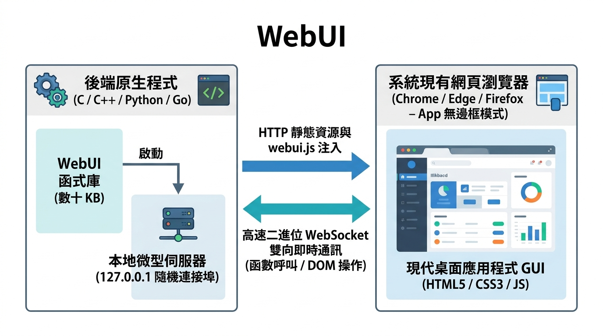
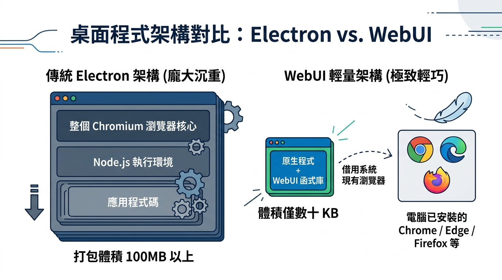
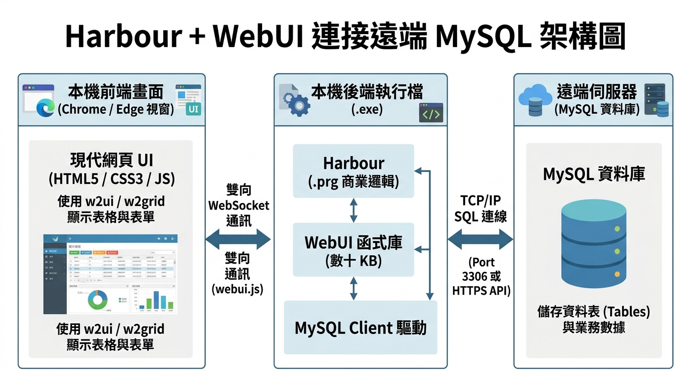

# WebUI 運作原理解析

**WebUI** 的核心運作原理是：**利用作業系統中已安裝的現代網頁瀏覽器（或原生 WebView）作為前端 GUI 視窗，並透過內建的輕量級本地 HTTP 與雙向二進位 WebSocket 伺服器，與後端原生程式進行即時通訊。**

與 Electron（內嵌整個 Chromium 與 Node.js）或 Tauri（依賴作業系統內建的 WebView2 / WebKit 渲染引擎與複雜的橋接層）不同，WebUI 本身**不包含任何網頁渲染引擎**，這使得編譯後的執行檔極小且幾乎沒有額外執行期依賴。

---

## 一、前後端是如何連起來的？（核心通訊原理）

你可以把 WebUI 想像成**「在自己電腦上開一個只有你自己看得到的迷你網站」**：

1. **後端原生程式（你的程式本體）：**
   當後端程式（如 C / C++ / Python / Go 等）呼叫 `webui_new_window()` 並執行 `webui_show()` 時，WebUI 函式庫會在背景啟動一個綁定於本地迴路（`127.0.0.1`）隨機閒置連接埠的輕量級伺服器，僅佔用數十 KB。
2. **系統現有網頁瀏覽器（畫面視窗）：**
   WebUI 會自動偵測系統上已安裝的瀏覽器（如 Chrome、Edge、Firefox、Brave 等），並以**無工具列、無網址列的應用程式模式（App Mode）**啟動瀏覽器，同時建立**獨立的私人設定檔（Private Profile）**，讓它看起來像原生桌面軟體且不干擾日常上網的分頁與快取。
3. **雙向即時通訊（高速二進位 WebSocket 專線）：**
   網頁載入時會自動引入 ``，在後端程式與瀏覽器視窗之間建立一條**高速二進位 WebSocket 連線**：
   * **前端呼叫後端：** 使用者在畫面上操作（如點擊按鈕），`webui.js` 會透過 WebSocket 呼叫後端綁定（`webui_bind()`）的原生函數並取得回傳結果。
   * **後端操作前端：** 後端可隨時透過 `webui_run()` 或 `webui_script()` 推送 JavaScript 指令到瀏覽器端修改 DOM 或更新畫面。

---

## 二、為什麼它比 Electron 輕這麼多？（打包體積差異）

* **傳統 Electron 架構（左邊）：**
  為了確保每台電腦都能顯示網頁介面，它把**「一整套 Chromium 瀏覽器核心 + Node.js」直接塞進安裝檔裡**。就算只寫一個簡單的「Hello World」視窗，打包體積也是 100MB 起跳。
* **WebUI 輕量架構（右邊）：**
  直接借用使用者電腦裡原本就裝好的 Chrome、Edge 或 Firefox 來渲染介面。執行檔內完全不包含瀏覽器引擎，只需連結僅**數十 KB** 的 WebUI 函式庫即可運行，兼具極致輕巧與現代 HTML5/CSS3/JS 完整功能。

---

## 三、常見架構問題（遠端連線與 HTTPS）

### 1. 支援遠端使用瀏覽器執行嗎？
**支援**，但預設基於安全考量僅綁定 `127.0.0.1`。若要開放區網或遠端連入，需進行以下設定：
* **開放外部連線：** 呼叫 `webui_set_public(my_window, true)` 監聽 `0.0.0.0`。
* **指定固定 Port：** 呼叫 `webui_set_port(my_window, 8080)` 固定連接埠。
* **無頭背景啟動：** 改用 `webui_show_browser(my_window, "index.html", NoBrowser)`，等待遠端瀏覽器輸入 `http://主機IP:8080` 連線。

### 2. 支援 HTTPS 連線嗎？
**支援**，兩種實作方式：
* **原生編譯 TLS 版本：** 編譯 WebUI 時加入 `WEBUI_USE_TLS=1` 連結 OpenSSL，並於程式中呼叫 `webui_set_tls_certificate()` 載入 PEM 憑證與私鑰。
* **透過反向代理（Reverse Proxy，推薦）：** 維持 WebUI 本身在 `127.0.0.1` 跑純 HTTP/WS，前端由 **Apache** 或 **Nginx** 掛載 SSL 憑證處理 HTTPS（Port 443），再將 HTTP 與 WebSocket 流量反向代理轉發至本機 WebUI 連接埠。

---

## 四、系統定位與資料庫連線架構（以 Harbour + WebUI 為例）

### 1. 系統定位：Local 桌面應用程式的現代 UI 引擎
WebUI 的核心定位就是用來開發**本地（Local）桌面應用程式**，本質上是傳統桌面 UI 框架（如 Win32 GUI、FiveWin、GTK、Qt 或 Electron）的輕量級替代品。

### 2. 如何連接遠端資料庫（例如 MySQL）？

**WebUI 本身完全不管資料庫連線**——資料庫是由你的**後端原生程式**直接連接的，前端網頁介面只負責顯示資料與接收使用者操作：

1. **左邊（本機前端畫面）：** 原本用 FiveWin 畫的視窗，現在換成用 HTML5 / CSS3 / JS（例如 `w2ui`、`w2grid`）呈現在 Chrome 或 Edge 視窗裡，只負責顯示介面，完全不接觸資料庫連線細節。
2. **中間（本機後端執行檔 `.exe`）：** 你的 Harbour `.prg` 商業邏輯、**WebUI 函式庫（數十 KB）** 以及 **MySQL Client 驅動程式**（如 `libmysqlclient` / `libmariadb`）全部編譯打包在同一個 `.exe` 裡。它一邊透過雙向 WebSocket 接收前端按鈕指令，另一邊直接負責跟遠端 MySQL 溝通。
3. **右邊（遠端伺服器）：** 遠端的 MySQL 資料庫只負責接收中間層 `.exe` 送過來的 SQL 查詢與寫入請求，再把資料交給 Harbour 打包成 JSON 回傳給左邊畫面更新。

> **實務部署資安提醒：**
> * **內部區網 / VPN 環境：** 後端程式直接透過 `libmysqlclient` 連內網 MySQL IP 即可，效能最佳。
> * **外部公網環境：** 建議避免直接對公網暴露 MySQL 3306 Port，改在遠端伺服器開一支 HTTP/HTTPS API（如 PHP / Node.js / Go），讓本機的 WebUI 後端程式透過 `libcurl` 呼叫 API 存取資料庫。

### 3. 與 `Harbour + FiveWin` 的架構對照

將原有的 `Harbour + FiveWin` 桌面系統轉換為 `Harbour + WebUI` 時，商業邏輯與資料庫連線程式碼皆無須重寫，僅將 UI 渲染層替換為現代瀏覽器介面：

| 架構層級 | 原本的架構 (`Harbour + FiveWin`) | 新的架構 (`Harbour + WebUI`) |
| :--- | :--- | :--- |
| **核心語言與商業邏輯** | Harbour (`.prg` 程式碼) | **完全不變**，依然是 Harbour (`.prg`) |
| **資料庫讀寫（MySQL / DBF）** | Harbour 直接透過 RDD / `libmysql` 連資料庫 | **完全不變**，依然由 Harbour `.prg` 直接讀寫資料庫 |
| **UI 介面渲染層** | FiveWin 呼叫 Windows 原生控制項（Dialog、Browse） | **換成 HTML5 / CSS3 / JS**（如 `w2ui`、`w2grid`）交給本機 Chrome/Edge 顯示 |
| **UI 橋接函式庫** | 連結 `FiveH.lib` / `FiveHC.lib` | 改連結 **`webui-2-static.lib`（或 `webui-2.dll`）** + 幾支 C89 介面包裝函數 |
| **最終發布產物** | 單一獨立 `.exe`（搭配 `libmysql.dll` 等） | **同樣是單一獨立 `.exe`**（體積幾乎不變，多一個 `webui-2.dll` 或直接靜態編入） |
